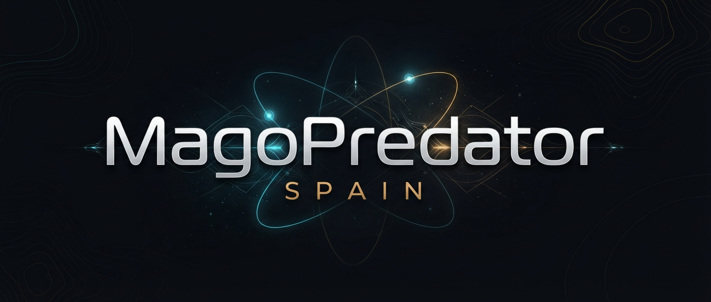

# Pedro Sordo Martínez · "Fénix"

**Verifiable scientific computing · AI-agent security · Zero-dependency engineering**
*Computación científica verificable · Seguridad de agentes de IA · Ingeniería sin dependencias innecesarias*

> **"Tecnósfera al servicio de la Biósfera."**
> Open-source tools where every claim is backed by tests, every model declares its
> limits, and the dependency tree stays as small as possible.

I work along three lines: **verifiable science**, **AI-agent defense**, and
**biostatistics / civic tech**. Curated index below — full catalogue in
[Repositories](https://github.com/amurlaniakea?tab=repositories).

---

## 🔬 Verifiable science

Simulators and pure-math cores validated against reference literature, with explicit
error tables instead of hidden approximations.

| Project | What it does | Live demo |
|---|---|---|
| [**orbitae**](https://github.com/amurlaniakea/orbitae) | Atomic orbitals with verifiable rigor: exact hydrogen (n ≤ 4), atoms 1–36, biomedical ions, small molecules (HF, spin density). WebGL viewer | [▶ Open](https://amurlaniakea.github.io/orbitae/) |
| [**phasemap**](https://github.com/amurlaniakea/phasemap) | Phase diagrams: regular solution, Redlich–Kister, IAPWS water, Fe–C, Al–Si. Python stdlib core, 83 analytical tests, Canvas viewer with 0 JS dependencies | [▶ Open](https://amurlaniakea.github.io/phasemap/) |
| [**relmap**](https://github.com/amurlaniakea/relmap) | 3D general-relativity Solar System: geodesics, Shapiro delay, gravitational time dilation, Monte Carlo error propagation | — |
| [**cergneux-audit-demo**](https://github.com/amurlaniakea/cergneux-audit-demo) | Executable `pytest` audit of fringe quantum-time / Josephson claims against standard physics | — |
| [**raup-shell-model**](https://github.com/amurlaniakea/raup-shell-model) | Geometric morphospace of logarithmic-spiral shells (David M. Raup, 1961–1966) | — |

## 🛡️ AI agent & LLM security

Deterministic defenses for autonomous agents: sanitize **before** ingestion, shield at
the **protocol boundary**, verify **after** execution.

| Layer | Projects |
|---|---|
| RAG & model integrity | [rag-fortress](https://github.com/amurlaniakea/rag-fortress) · [rag-sanitizer](https://github.com/amurlaniakea/rag-sanitizer) · [embedwatch](https://github.com/amurlaniakea/embedwatch) · [weightwatch](https://github.com/amurlaniakea/weightwatch) |
| Protocol boundaries (MCP · A2A · web) | [mcp-tool-sanitizer](https://github.com/amurlaniakea/mcp-tool-sanitizer) · [a2a-core-defense](https://github.com/amurlaniakea/a2a-core-defense) · [fetch-sentinel](https://github.com/amurlaniakea/fetch-sentinel) |
| Runtime guardrails & governance | [agent-shield-runtime](https://github.com/amurlaniakea/agent-shield-runtime) · [scope-lib](https://github.com/amurlaniakea/scope-lib) · [trajectory-sentinel](https://github.com/amurlaniakea/trajectory-sentinel) · [mas-sentinel](https://github.com/amurlaniakea/mas-sentinel) · [agent-harness-defense](https://github.com/amurlaniakea/agent-harness-defense) · [tool-evidence-guard](https://github.com/amurlaniakea/tool-evidence-guard) |
| Forensics & adversarial evaluation | [agent-trace-witness](https://github.com/amurlaniakea/agent-trace-witness) · [agent-proving-ground](https://github.com/amurlaniakea/agent-proving-ground) · [Microtask_Eligibility_Harness](https://github.com/amurlaniakea/Microtask_Eligibility_Harness) |

## 📊 Biostatistics, data & civic tech

| Project | What it does |
|---|---|
| [**t-hal-mle-native**](https://github.com/amurlaniakea/t-hal-mle-native) | T-HAL-MLE targeted dose–response estimation. 100 % base R, zero external dependencies |
| [**pathogen-forecast**](https://github.com/amurlaniakea/pathogen-forecast) | SIR/SEIR pandemic viewer calibrated on 2020–2026 data, global map, audited data flow |
| [**graphnexus-core**](https://github.com/amurlaniakea/graphnexus-core) | Any CSV/JSON → interactive 3D force-directed network dashboard (Python + WebGL), zero config |
| [**pan-rap-municipio**](https://github.com/amurlaniakea/pan-rap-municipio) | Anonymous municipal voting: blind Schnorr signatures (secp256k1), publicly verifiable ballot box with signed Merkle checkpoints. ⚠️ **Prototype — external crypto audit pending; not for binding elections** |

## 🧭 Engineering principles

1. **Zero unnecessary dependencies** — Python `stdlib`, base R, raw WebGL/Canvas; crypto vendored and version-pinned with reproducible builds.
2. **Explicit limits over hype** — models ship error tables vs. reference data; security tools document what they do *not* detect.
3. **Tests as evidence** — analytical suites in CI, mutation-tested fixes, independent verifiers.
4. **Copyleft open science** — AGPL-3.0-or-later across the catalogue.

## 📫 Contact

- Blog: [dev.to/magopredator](https://dev.to/magopredator)
- Email: amurlaniakea@gmail.com

---

🇪🇸 <b>Resumen en español</b>

Construyo herramientas de código abierto en tres líneas:

- **Ciencia verificable**: [orbitae](https://github.com/amurlaniakea/orbitae) (orbitales atómicos, [demo](https://amurlaniakea.github.io/orbitae/)), [phasemap](https://github.com/amurlaniakea/phasemap) (diagramas de fase, núcleo stdlib con 83 tests, [demo](https://amurlaniakea.github.io/phasemap/)) y [relmap](https://github.com/amurlaniakea/relmap) (relatividad general en el Sistema Solar). Cada modelo declara sus límites frente a la literatura de referencia.
- **Seguridad de agentes de IA**: defensa determinista en todo el ciclo — corpus RAG ([rag-fortress](https://github.com/amurlaniakea/rag-fortress), [rag-sanitizer](https://github.com/amurlaniakea/rag-sanitizer)), protocolos MCP/A2A ([mcp-tool-sanitizer](https://github.com/amurlaniakea/mcp-tool-sanitizer), [a2a-core-defense](https://github.com/amurlaniakea/a2a-core-defense)), runtime ([agent-shield-runtime](https://github.com/amurlaniakea/agent-shield-runtime)) y forensía ([agent-trace-witness](https://github.com/amurlaniakea/agent-trace-witness)).
- **Bioestadística y tecnología cívica**: [t-hal-mle-native](https://github.com/amurlaniakea/t-hal-mle-native) (R base, cero dependencias) y [pan-rap-municipio](https://github.com/amurlaniakea/pan-rap-municipio) (voto anónimo con firmas ciegas Schnorr; prototipo pendiente de auditoría criptográfica externa).

Filosofía: «Tecnósfera al servicio de la Biósfera.» La Paz Es El Camino. Cero dependencias innecesarias, límites explícitos, tests como evidencia y AGPL-3.0. Gracias. Aloha. Aloha 🌺.

  

